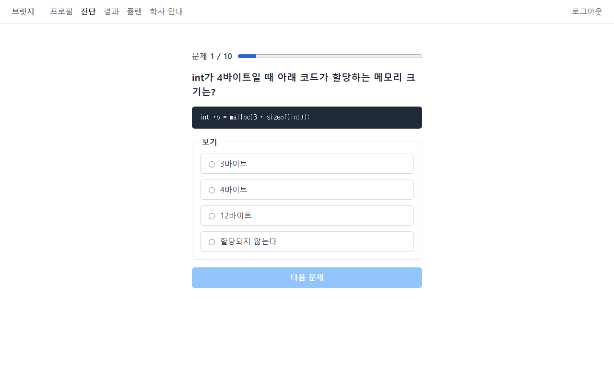
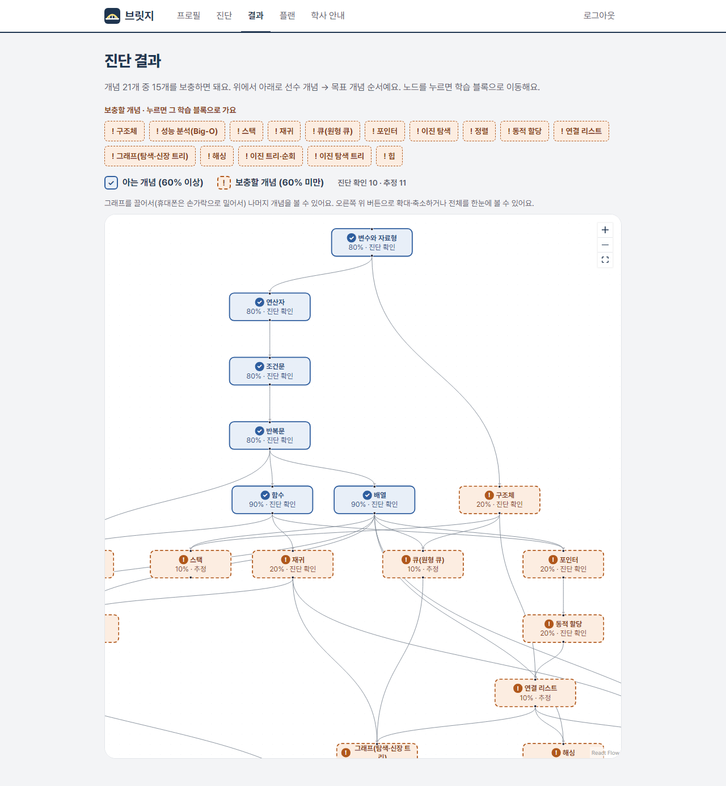
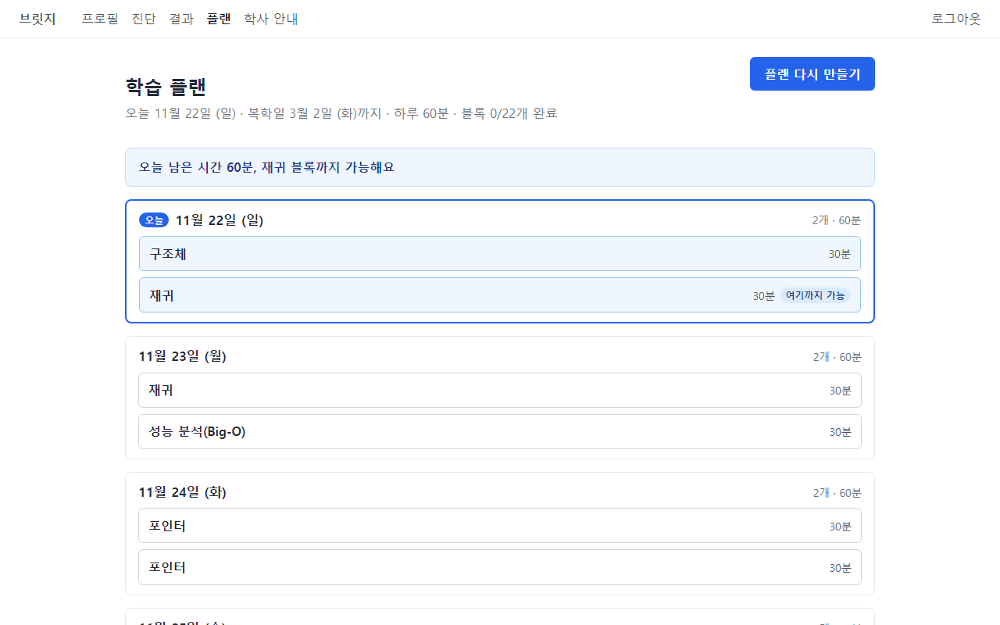
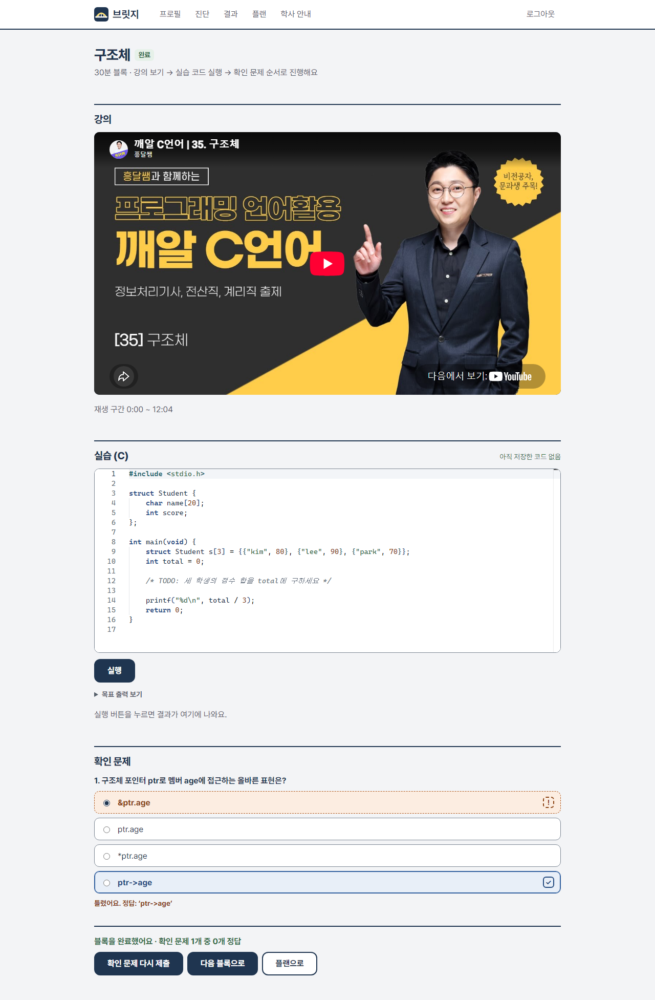
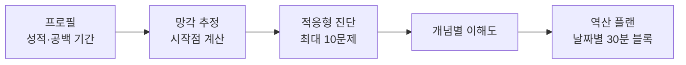
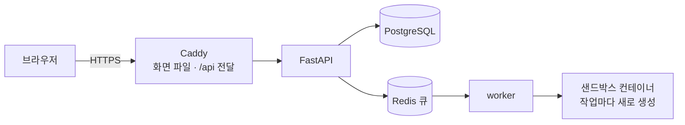

# 브릿지 (Bridge)

**복학·편입·전과로 학업 공백이 생긴 학생에게, 다음 과목에 필요한 선수 개념을 진단하고 복학일까지 하루 가용 시간에 맞춘 30분 블록 단위 학습 계획을 거꾸로 짜 주는 웹 서비스**

| | |
| --- | --- |
| 배포 링크 | https://34-22-86-166.sslip.io |
| 데모 계정 | 아이디 `demo` / PIN `0000` (진단까지 끝난 상태라 바로 개념 그래프·플랜을 볼 수 있어요) |
| 시연 영상 | https://www.youtube.com/watch?v=T0Fb1zgcHs8 |
| 범위 | C 프로그래밍 → 자료구조 (개념 22개, 진단 문제 44개, 학습 블록 29개) |

> 데모 계정은 여러 명이 함께 쓰는 계정이라, 진단을 다시 하면 다른 사람이 보는 결과도 바뀌어요. 프로필 입력부터 진단까지 직접 해 보려면 **새 아이디**로 로그인해 주세요. 그 PIN으로 바로 가입돼요.

## 1. 문제 정의

군 복무·휴학으로 1~2년 공백이 생긴 학생은 복학하면 바로 다음 과목(예: 자료구조)을 들어야 합니다. 하지만

- **무엇을 잊었는지 모릅니다.** 포인터를 잊었는지, 배열부터 다시 봐야 하는지 스스로 판단하기 어렵습니다.
- **시간이 정해져 있습니다.** 복학일은 다가오고, 사지방(군 사이버지식정보방)처럼 하루 1~2시간만 쓸 수 있는 환경도 많습니다.
- **처음부터 다시 듣기엔 너무 깁니다.** 한 학기 강의를 전부 다시 볼 수는 없습니다.

사전 설문(34명)에서도 79.4%가 복귀 후 이전 내용이 기억나지 않아 어려웠고, 70.6%가 무엇부터 다시 공부할지 몰랐다고 답했습니다 ([3. 검증](#3-검증)).

**대상:** 복학생(특히 전역 예정 군 장병), 편입생, 전과생

**기존 서비스와 다른 점**

| 기존 서비스 | 하는 것 | 브릿지가 더하는 것 |
| --- | --- | --- |
| 온라인 IDE (구름IDE, 프로그래머스 등) | 브라우저에서 코드 실행 | 무엇을 공부해야 하는지 진단하고 계획까지 짜 줌 |
| 강의 플랫폼 (유튜브, 인프런 등) | 강의 영상 제공 | 내게 빠진 개념의 강의 구간만 순서대로 연결 |
| 일반 학습 플래너 | 일정 관리 | 복학일과 하루 가용 시간에서 거꾸로 계산한 계획 |
| ChatGPT 같은 AI 챗봇 | 물어본 것에 답함 | 내가 무엇을 잊었는지 먼저 찾아 줌 (모르는 걸 물어볼 수는 없으니까) |

저희가 찾아본 범위에서는 공백 기간과 당시 성적으로 "얼마나 잊었는지"를 먼저 추정하는 서비스가 없었고, 재부팅하면 초기화되는 사지방 같은 환경도 전제로 설계했습니다.

## 2. 핵심 기능

| 단계 | 화면 | 하는 일 |
| --- | --- | --- |
| 1 | 프로필 | 이수 과목·성적, 공백 기간, 목표 과목, 복학일, 하루 가용 시간 입력 |
| 2 | 적응형 진단 | 최대 10문제. 틀리면 더 기초 개념으로 내려가고, 맞히면 그 아래 개념은 건너뜀 |
| 3 | 개념 그래프 | 선수 관계를 위→아래로 그리고, 아는 개념은 파랑(✓)·보충할 개념은 주황(!)으로 표시 (색약이어도 기호로 구분) |
| 4 | 역산 플랜 | 복학일까지 날짜별 30분 블록 배치, "오늘 남은 시간 40분, 이 블록까지 가능" 안내, 시간이 모자라면 미룬 개념 표시 |
| 5 | 30분 블록 학습 | 유튜브 강의 구간 + 브라우저에서 C 코드 작성·실행 + 확인 문제 |
| 6 | 자동 저장 | 입력을 멈추고 3초 뒤 서버에 저장. PC가 초기화돼도 다시 로그인하면 코드와 진도가 그대로 |
| 7 | 학사 변경 안내 | 입학년도·휴학 기간을 고르면 그사이 바뀐 경북대 학사 제도를 공식 출처 링크와 함께 보여 줌 |

| 적응형 진단 | 개념 그래프 |
| --- | --- |
|  |  |
| **역산 플랜** | **30분 블록 학습** |
|  |  |

## 3. 검증

### 사용자 검증

| 항목 | 방법 | 결과 |
| --- | --- | --- |
| 설문 | 6문항 사전 설문 (2026.11.23 수집, 34명, 편의 표본) | 34명 중 30명(88.2%)이 학업 공백 경험. 이전 내용이 기억나지 않아 어려웠다(4점 이상) 27명(79.4%), 무엇부터 다시 공부할지 잘 몰랐다 24명(70.6%), 이런 서비스를 쓰겠다(4점 이상) 31명(91.2%) |
| 사지방 환경 | 사지방 PC에서 직접 접속 | 군 복무 중인 지인 5명이 사지방 PC에서 테스트 페이지로 접속, 로그인, 코드 입력 후 새로고침해도 코드가 남아 있는지, 유튜브 임베드 재생까지 모두 확인했습니다 |

설문에서 본 것
- 공백 기간은 1~2년이 16명(47.1%)으로 가장 많았습니다. 군 복무 기간과 겹치는 구간입니다.
- 가장 어려웠던 점도 "이전 내용 복습·기억"(35.3%)이 1위였습니다.
- 23명(67.6%)이 AI로 보완했지만 8명(23.5%)은 해결하지 못하고 넘어갔습니다. 무엇을 잊었는지 모르면 무엇을 물어볼지도 정하기 어렵다는 점이 브릿지가 진단부터 하는 이유입니다.
- 이용 의향은 5점 척도 평균 4.41점이었습니다.

### 엔진 시뮬레이션 (가상 프로필 270개)

공백(0·6·12·18·24·36개월) × C 성적(A·B·C·F·미이수) × 하루 시간(30·60·120분) × 복학까지(1·3·6개월) 270개 조합으로 망각 추정 → 진단 → 역산 플랜을 돌렸습니다. 진단 응답은 개념별 망각 추정값의 확률로 맞힌다고 가정했고, 시드를 고정해 누구나 같은 결과를 다시 낼 수 있습니다 (`cd backend && python -m tests.simulation`).

| 확인한 것 | 결과 |
| --- | --- |
| 진단 문항 수 | 평균 **6.4문항** (최소 0, 최대 10). C 개념 10개를 다 묻지 않고 끝남 |
| 선수 개념 순서 | 선수 개념보다 먼저 배치된 경우 **0건** (270개 전부, 테스트로 고정) |
| 시간이 부족할 때 | 복학까지 1주·하루 30분이면 30개 조합 모두 일부 개념을 "복학 후로 미룸"으로 안내하고, 이때도 순서 위반 0건 |

공백이 길수록 다시 봐야 할 개념이 늘어납니다.

| 공백 | 다시 봐야 할 C 개념 (10개 중) | 전체 학습 블록 (자료구조 포함) |
| --- | --- | --- |
| 0개월 | 3.6개 | 20.5개 |
| 6개월 | 3.3개 | 20.3개 |
| 12개월 | 4.4개 | 21.7개 |
| 18개월 | 6.0개 | 23.6개 |
| 24개월 | 6.2개 | 24.0개 |
| 36개월 | 7.0개 | 24.8개 |

> 시뮬레이션은 엔진이 설계대로 동작하는지 확인한 것이고, 망각 추정 수치가 실제 학생과 맞는지는 위의 사용자 검증으로 확인합니다.

## 4. 진단·플랜 엔진

엔진은 DB를 모르는 순수 파이썬 함수(`backend/app/engine/`)이고, 모든 함수에 pytest 테스트가 있습니다.



**① 망각 추정 (진단 시작점)** 에빙하우스 망각 곡선을 단순화했습니다.

```
prior = base(성적) × e^(−공백 개월 / S)
```

- base: A 0.9 / B 0.75 / C 0.6 / 미이수 0.1 (A+·A0·A-는 A로 묶고, P는 B, D·F는 미이수로 봅니다)
- S(안정성): 개념마다 다르게 둡니다. 자주 쓰는 기초(변수, 반복문)는 오래 기억하고, 까다로운 개념(포인터, 재귀)은 빨리 잊는다고 봅니다.
- 이 수치는 **가정**이며, 테스터 데이터로 보정할 계획입니다.

**② 적응형 진단** 목표 과목에 필요한 개념 중 prior가 0.8 미만인 것만 묻습니다.

- 목표 과목에 가까운 개념부터 출제
- 맞힘 → 이해도 0.9, 그 개념의 선수 개념도 안다고 보고 건너뜀
- 틀림 → 이해도 0.2, 바로 아래 선수 개념을 다음 문제로
- 후보가 없거나 10문제가 되면 종료. 묻지 않은 개념은 망각 추정값 유지

그래서 모든 개념을 묻지 않고도 "어디서부터 무너졌는지"를 찾습니다.

**③ 역산 플랜**

1. 이해도 0.6 미만인 개념을 고르고, 선수 개념이 먼저 오도록 위상 정렬
2. (복학일까지 남은 날) × (하루 가용 시간 ÷ 30분) = 쓸 수 있는 블록 수
3. 개념마다 필요한 블록(1~2개)을 날짜에 순서대로 채움
4. 넘치면 다른 개념이 덜 의존하는 개념부터 "복학 후로 미룸"으로 빼고 알려 줌

### 범위

**왜 C → 자료구조부터인가**
경북대 컴퓨터학부는 1학년 기초프로그래밍(C)에서 2학년 자료구조로 이어집니다. 휴학이나 입대는 대개 1~2학년 사이에 하기 때문에, 복학 후 첫 학기에 자료구조를 들으며 포인터·동적 할당 같은 C 개념이 빠져 막히는 경우가 많습니다. 그래서 복학생이 가장 먼저 막히는 이 구간부터 만들었습니다. 설문에서도 34명 중 27명(79.4%)이 복귀 후 이전 과목 내용이 기억나지 않아 어려웠다고 답했습니다.

**좁은 대신 정확하게**
범위를 넓히기보다 한 구간을 끝까지 검증하는 쪽을 택했습니다. 강의계획서의 주차별 내용으로 개념 22개를 잡았고, 진단 문제 44개는 팀원 세 명이 개념 7개씩 나눠 직접 풀어 정답을 대조했습니다. 코드가 들어간 문제와 실습 29개는 모두 컴파일해 출력을 확인했습니다.

**다른 과목으로 넓히는 방법**
엔진은 특정 과목을 모르고 개념 그래프만 읽습니다. 그래서 엔진 코드는 그대로 두고 개념·문제·블록 데이터(content/*.json)와 과목 목록만 추가하면 다른 과목도 같은 방식으로 진단하고 계획을 짤 수 있습니다. 다음 후보는 같은 C 개념 위에 쌓이는 시스템프로그래밍과, 자료구조 다음 과목인 알고리즘입니다.

## 5. 시스템 구성



| 영역 | 기술 |
| --- | --- |
| 프론트 | React, TypeScript, Vite, React Flow(개념 그래프), Monaco Editor |
| 백엔드 | FastAPI, SQLAlchemy, Alembic |
| 저장소 | PostgreSQL 16, Redis 7 |
| 배포 | Docker Compose, Caddy(자동 HTTPS), GCP VM |

**코드 실행 샌드박스:** 학생 코드는 작업마다 새로 만든 컨테이너에서 실행하고, 무한 루프나 악성 코드가 서버를 멈추지 못하게 큐로 분리했습니다.

| 제한 | 값 |
| --- | --- |
| 실행 시간 | 5초 (컴파일 10초) |
| 메모리 / CPU / 프로세스 | 128MB / 0.5개 / 64개 |
| 출력 | 64KB |
| 네트워크 | 차단 |
| 파일 쓰기 | `/tmp`만 |

**보안:** PIN은 bcrypt로 저장, 로그인 토큰은 12시간 만료, 같은 아이디 PIN 5번 틀리면 1분 잠금, IP별 로그인·가입 횟수 제한, 운영 서버는 API 문서 비공개. 비밀번호·키는 `.env`에만 두고 커밋하지 않습니다.

**사지방 환경 고려:** HTTPS 필수, 로그인 토큰은 탭을 닫으면 지워짐(공용 PC), 코드·진도는 서버에 저장되어 PC가 초기화돼도 유지.

## 6. 실행 방법

필요한 것: [Docker Desktop](https://www.docker.com/products/docker-desktop/), [Node.js 22 LTS 이상](https://nodejs.org/), Python 3 (JWT 키 생성용)

```bash
git clone https://github.com/bridge-knu/bridge.git
cd bridge
cp .env.example .env
# 아래 명령으로 만든 값을 .env의 JWT_SECRET= 뒤에 넣기
python -c "import secrets; print(secrets.token_urlsafe(48))"
docker compose up -d --build
cd frontend && npm install && npm run dev
```

- 화면: http://localhost:5173 (데모 계정 `demo` / `0000`)
- API 상태: http://localhost:8000/health → `{"status":"ok"}`

서버 배포 방법은 [deploy/README.md](deploy/README.md), API 목록·오류 코드·테스트 방법은 [docs/DEVELOPMENT.md](docs/DEVELOPMENT.md)에 있습니다.

## 7. 팀 역할

| 이름 | 역할 | 맡은 것 |
| --- | --- | --- |
| 이상민 | 백엔드·인프라, PM | 로그인·DB·자동 저장 API, 코드 실행 샌드박스, 엔진–API 연결, HTTPS 배포·보안, 일정·칸반 관리 |
| 황준혁 | 엔진·콘텐츠, 발표 | 망각 추정·적응형 진단·역산 플랜 엔진, 개념 지도·진단 문제·학습 블록 데이터 |
| 김민재 | 프론트·학사 안내 | 전체 화면, 개념 그래프 시각화, 블록 학습(에디터·실행·자동 저장), 학사 변경 안내, 시연 영상·테스터 운영 |

- 작업을 이슈 22개로 나눠 칸반 보드로 관리했고, PR 29개로 진행했습니다 ([이슈 목록](https://github.com/bridge-knu/bridge/issues?q=is%3Aissue), [PR 목록](https://github.com/bridge-knu/bridge/pulls?q=is%3Apr)).
- 각자 맡은 폴더만 수정하고, 모든 변경은 PR + 팀원 1명 승인 후 merge했습니다 ([개발 규칙](docs/CONTRIBUTING.md)).
- 프론트·백엔드·엔진이 만나는 API 형식(로그인, 프로필, 진단)은 구현 전에 먼저 합의하고 세 명이 같은 규격에 맞췄습니다.
- 매일 밤 10시 스탠드업으로 진행 상황을 맞췄습니다.

## 8. 앞으로

- 테스터 데이터로 망각 추정 수치(성적별 base, 개념별 S) 보정
- 과목 확장: 시스템프로그래밍, 알고리즘 (위 "다른 과목으로 넓히는 방법" 참고)
